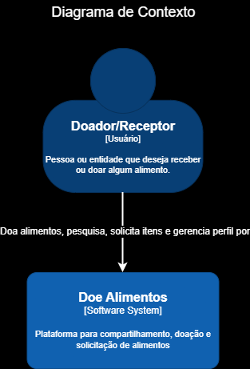
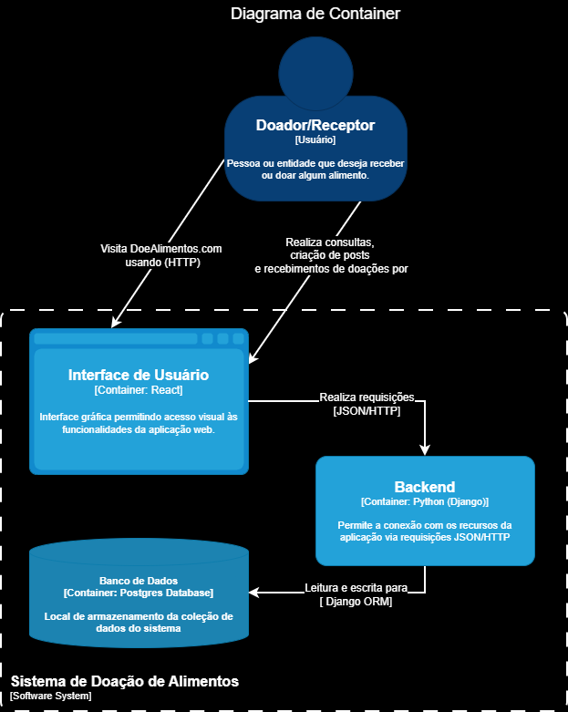
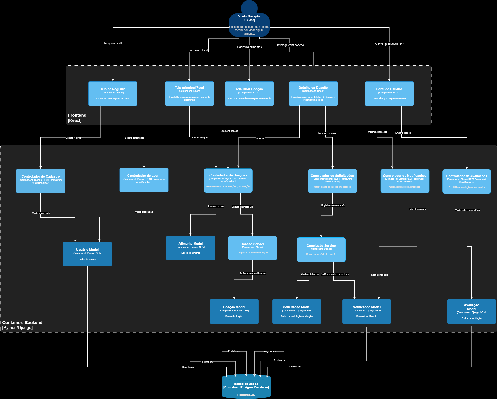

# Aplicativo de Doação de Alimentos.

Um site que tem como objetivo facilitar na doação de alimentos no Brasil através de uma plataforma onde usuários podem anunciar doações, enquanto outros usuários podem reinvindicar as doações.   

### **Integrantes**
- 245210, Carlos Miguel Costa Santiago da Conceição

- 251055, Gabriel Cunha Marchetti

- 231528, Vinicius Forato Coracin

- 257111, Guilherme Webster Chamoun

- 260230, Maria Cecília Torres Vianna

# Inicialização do Repositório:

## Crie um ambiente virtual Python:
```
python -m venv .venv
```
Inicialize o Virtual Env através do comando:
```
source .venv/bin/activate       # Para Linux
.\.venv\Scripts\Activate.ps1    # Para Windows
```

## Instale as dependências e Inicialização do Backend:
```
pip install -r requirements.txt
python manage.py migrate
python manage.py runserver
```

## Dependencias via pyproject.toml (recomendado)

Para desenvolvimento (inclui ferramentas de qualidade):

```
pip install -e ".[dev]"
```

Para usar semantic release no backend:

```
pip install -e ".[release]"
```

Executar release em modo de teste:

```
semantic-release version --noop
```

## Usando PostgreSQL

O projeto agora aceita PostgreSQL por variáveis de ambiente, com SQLite como fallback. Isso permite começar simples e trocar de banco sem reescrever o backend.

1. Instale o PostgreSQL na sua máquina.
2. Crie um banco de dados com o nome que quiser, por exemplo `doacao_alimentos`.
3. Crie um arquivo `.env` na raiz do projeto com base em `.env.example`.
4. Preencha os dados de acesso do seu banco.
5. Rode as migrations novamente.

Exemplo de `.env`:


```
USE_POSTGRES=true
POSTGRES_DB=doacao_alimentos
POSTGRES_USER=postgres
POSTGRES_PASSWORD=sua_senha
POSTGRES_HOST=localhost
POSTGRES_PORT=5432
```

Se houver um problema de abrir o banco de dados você pode rodar os seguintes comandos:

Para verificar se o postgresql está sendo executado dentro do seu sistema.
```
sudo systemctl status postgresql
```

Caso ele esteja desabilitado você poderá executar:
```
sudo systemctl start postgresql
```

Comandos para aplicar no banco PostgreSQL:

```
python manage.py migrate
python manage.py runserver
```

Se quiser voltar temporariamente para SQLite, basta remover o `.env` ou definir `USE_POSTGRES=false`.

## Inicialização do frontend
```
cd frontend
npm install
npm run dev
```

## Testes Automatizados (Pytest)

O repositório está configurado para executar testes com `pytest` e `pytest-django` usando o arquivo `pytest.ini` na raiz do projeto.

### 1. Preparar ambiente

Crie e ative o ambiente virtual:

```
python -m venv .venv
source .venv/bin/activate       # Linux
.\.venv\Scripts\Activate.ps1    # Windows
```

### 2. Preparar banco para os testes

```
python manage.py migrate
```

### 3. Executar os testes

Execute todos os testes:

```
pytest
```

Executar um arquivo específico:

```
pytest tests/tests.py
```

Também dá para executar pela janela de testes do VSCode

### 4. Configurar VS Code para reconhecer os testes

1. Selecione o interpretador Python do projeto (`.venv`) em **Python: Select Interpreter**.
2. Abra o painel **Testing** e rode **Python: Discover Tests**.
3. O VS Code usa as configurações de `.vscode/settings.json` para chamar o pytest na pasta `tests`, é lá que devem ficar seus testes.

Observação: use `pytest` (sem `-c tests/pytest.ini`). O arquivo de configuração válido está na raiz (`pytest.ini`).

# Padronização dos commits para alteração do semantic release.

Para incremento da versão patch utilize a mensagem dentro do commit:

fix: [mensagem]

Para incremento da versão minor utilize a mensagem dentro do commit:

feat: [mensagem]

Para incremento da versão major utilize a mensagem dentro do commit:

feat!: [mensagem]

Para não alterar nenhuma versão do semantic release:

chore: [mensagem]

## Requirements:
Python - 3.14.3+
npm - 10.9.2+

---

# Arquitetura do Sistema

Esta seção descreve a arquitetura do **Doe Alimentos**, baseada nos diagramas C4 (Contexto, Container e Componentes) elaborados para o projeto.

## Diagrama C4

Abaixo estão descritos os principais elementos em cada nível de hierarquia do modelo C4:

### 1. Nível de Contexto


* **Doador/Receptor (Usuário)**: Indivíduo ou instituição que acessa a plataforma para publicar alimentos excedentes ou solicitar doações disponíveis.
* **Doe Alimentos**: O sistema de software como um todo, que gerencia e conecta doadores e receptores.

### 2. Nível de Containers


### 3. Nível de Componentes


### 3. Nível de Componentes (Componentes)

#### Frontend (React / Vite)
* **Tela de Registro**: Pagina para preenchimento do cadastro de novos usuários.
* **Tela de Login**: Ambiente de autenticação do usuário.
* **Tela Principal/Feed**: Página principal para acesso aos recursos gerais do sistema (listagem de doações, perfil de usuário, cadastro de doação etc.)
* **Tela Criar Doação**: Tela para cadastro dos itens de doação.
* **Detalhes da Doação**: Pagina de consulta dos detalhes acerca de uma doação (descrição dos itens e status de doação)
* **Perfil do Usuário**: Painel do usuário contendo dados cadastrais, histórico, notificações e avaliações.

#### Backend (Django / Django REST Framework)
* **Controladores de Usuário e Login**: Gerenciam o cadastro de perfis e a autenticação do sistema.
* **Controlador de Doações**: Ponto de entrada de requisições de listagem e criação de novas categorias de alimentos.
* **Controlador de Solicitações**: Trata da reserva e manifestação de interesse em doações.
* **Controlador de Notificações e Avaliações**: Gerencia o envio de avisos de alteração de status e o sistema de reputação e notas dos usuários.

#### Banco de Dados (PostgreSQL): Ambiente de armazenamento das tabelas relacionais do sistema (usuários, doações, solicitações, notificações, avaliações etc).


## Estilos Arquiteturais Adotados

O sistema foi projetado para adotar uma combinação de estilos que visam garantir o desacoplamento, robustez e manutenibilidade:

1. **Cliente-Servidor**: O estilo arquitetural adotado permite a separação de responsabilidades entre o Frontend (desenvolvido em React, focado na interface e interação do usuário) e o Backend (construído como uma Django REST API, responsável pelas regras de negócio, validação e persistência de dados). Os dois módulos atuam de forma independente integrando-se através do protocolo HTTP, trocando mensagens no formato JSON. Dessa forma, o desacoplamento possibilita a praticidade no desenvolvimento paralelo, escalabilidade, reusabilidade de código e manutenibilidade do sistema.

3. **Padrão Model-View-Controller (MVC)**: Além do modelo Cliente-Servidor, o sistema foi projetado seguindo o padrão MVC (Model, View e Controller). A separação definida por esse padrão segmenta as responsabilidades, facilitando a manutenção, a evolução e os testes do sistema, o que permite um desenvolvimento modular e independente.

   #### **Model (Modelo)**
   O **Model** representa os dados e as regras de negócio associadas ao sistema. No projeto, ele é representado pelo banco de dados, componentes de lógica de negócio e models (que definem as estruturas de dados da aplicação e possibilitam a comunicação com o banco). O isolamento do Model permite que a parte de decisões lógicas seja mantida independente da interface, facilitando a manutenção e a evolução do sistema.

   #### **View (Visão)**
   A **View**, representada pelo frontend, é responsável pela apresentação gráfica dos dados ao usuário. Desenvolvida com ReactJS, ela se comunica com o backend por meio de requisições HTTPS/JSON. A segmentação do modelo permite que o frontend seja remodelado ou, até mesmo, substituído por outra tecnologia, sem que isso interfira nas regras de negócio da aplicação.

   #### **Controller (Controlador)**
   O **Controller** recebem as requisições HTTP do frontend, executam operações através dos componentes controladores, services e views, processando as requisições, atuando como intermediário entre Model e View. O Controllers funcionam como administradores traduzindo requisições HTTP em operações de negócio. Desta forma garante que a lógica HTTP, como o tratamento de erros, status codes e serialização, fique distante da lógica de negócio.
   
### Padrão de Projeto (State)
O padrão de projeto State foi adotado no post de doação para representar fase do ciclo de vida de cada doação (disponível, reservada, concluída, expirada, cancelada) como um comportamento distinto. A lógica de transição e as ações permitidas ficam encapsuladas na respectiva classe de estado. Dessa forma evita if/else espalhados no backend, deixando mais claro a função de cada status e facilitando a manutenção de cada fase do ciclo de vida.

