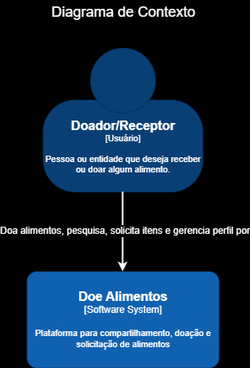

# Aplicativo de Doação de Alimentos.

Um site que tem como objetivo facilitar na doação de alimentos no Brasil através de uma plataforma onde usuários podem anunciar doações, enquanto outros usuários podem reinvindicar as doações.   

### **Integrantes**
- 245210, Carlos Miguel Costa Santiago da Conceição

- 248243, Caio Enzo dos Santos Nakayama 

- 205854, Gustavo Fernandes de Carvalho

- 176032, Lara Matias Pasquotti

- 176162, Lucas dos Santos Nunes

- 249893, Lucas Eduardo Ferreira

# Inicialização do Repositório:

## Crie um ambiente virtual Python:
```
python -m venv .venv
```
Inicialize o Virtual Env através do comando:
```
source .venv/bin/activate       # Para Linux
.\.venv\Scripts\Activate.ps1    # Para Windows
```

## Instale as dependências e Inicialização do Backend:
```
pip install -r requirements.txt
python manage.py migrate
python manage.py runserver
```

## Dependencias via pyproject.toml (recomendado)

Para desenvolvimento (inclui ferramentas de qualidade):

```
pip install -e ".[dev]"
```

Para usar semantic release no backend:

```
pip install -e ".[release]"
```

Executar release em modo de teste:

```
semantic-release version --noop
```

## Usando PostgreSQL

O projeto agora aceita PostgreSQL por variáveis de ambiente, com SQLite como fallback. Isso permite começar simples e trocar de banco sem reescrever o backend.

1. Instale o PostgreSQL na sua máquina.
2. Crie um banco de dados com o nome que quiser, por exemplo `doacao_alimentos`.
3. Crie um arquivo `.env` na raiz do projeto com base em `.env.example`.
4. Preencha os dados de acesso do seu banco.
5. Rode as migrations novamente.

Exemplo de `.env`:


```
USE_POSTGRES=true
POSTGRES_DB=doacao_alimentos
POSTGRES_USER=postgres
POSTGRES_PASSWORD=sua_senha
POSTGRES_HOST=localhost
POSTGRES_PORT=5432
```

Se houver um problema de abrir o banco de dados você pode rodar os seguintes comandos:

Para verificar se o postgresql está sendo executado dentro do seu sistema.
```
sudo systemctl status postgresql
```

Caso ele esteja desabilitado você poderá executar:
```
sudo systemctl start postgresql
```

Comandos para aplicar no banco PostgreSQL:

```
python manage.py migrate
python manage.py runserver
```

Se quiser voltar temporariamente para SQLite, basta remover o `.env` ou definir `USE_POSTGRES=false`.

## Inicialização do frontend
```
cd frontend
npm install
npm run dev
```

### 1. Preparar ambiente

Crie e ative o ambiente virtual:

```
python -m venv .venv
source .venv/bin/activate       # Linux
.\.venv\Scripts\Activate.ps1    # Windows
```

### 2. Preparar banco para os testes

```
python manage.py migrate
```

### 3. Executar os testes

Execute todos os testes:

```
pytest
```

Executar um arquivo específico:

```
pytest tests/tests.py
```

Também dá para executar pela janela de testes do VSCode


## Requisitos:
Python - 3.14.3+
npm - 10.9.2+

---

# Arquitetura do Sistema

Esta seção descreve a arquitetura do **Doe Alimentos**, baseada nos diagramas C4 (Contexto, Container e Componentes) elaborados para o projeto.


### 1. Nível de Contexto


* **Doador/Receptor (Usuário)**: Indivíduo ou instituição que acessa a plataforma para publicar alimentos excedentes ou solicitar doações disponíveis.
* **Doe Alimentos**: O sistema de software como um todo, que gerencia e conecta doadores e receptores.


### 3. Nível de Componentes (Componentes)

#### Frontend (React / Vite)
* **Tela de Registro**: Pagina para preenchimento do cadastro de novos usuários.
* **Tela de Login**: Ambiente de autenticação do usuário.
* **Tela Principal/Feed**: Página principal para acesso aos recursos gerais do sistema (listagem de doações, perfil de usuário, cadastro de doação etc.)
* **Tela Criar Doação**: Tela para cadastro dos itens de doação.
* **Detalhes da Doação**: Pagina de consulta dos detalhes acerca de uma doação (descrição dos itens e status de doação)
* **Perfil do Usuário**: Painel do usuário contendo dados cadastrais, histórico, notificações e avaliações.

#### Backend (Django / Django REST Framework)
* **Controladores de Usuário e Login**: Gerenciam o cadastro de perfis e a autenticação do sistema.
* **Controlador de Doações**: Ponto de entrada de requisições de listagem e criação de novas categorias de alimentos.
* **Controlador de Solicitações**: Trata da reserva e manifestação de interesse em doações.
* **Controlador de Notificações e Avaliações**: Gerencia o envio de avisos de alteração de status e o sistema de reputação e notas dos usuários.


