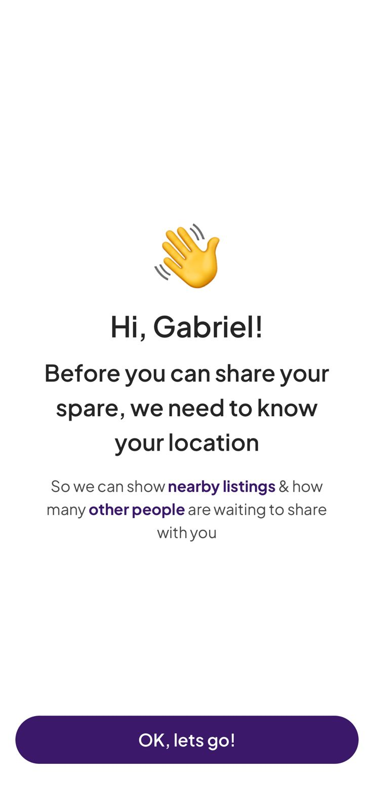
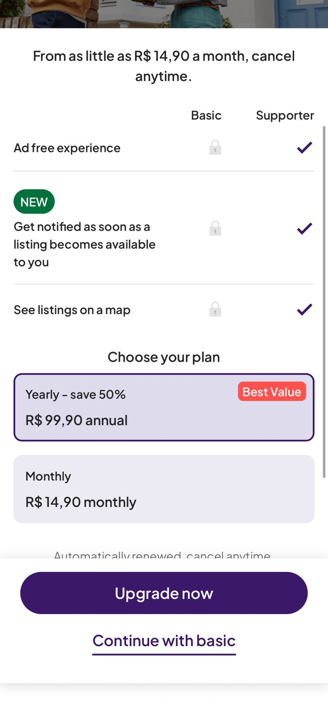
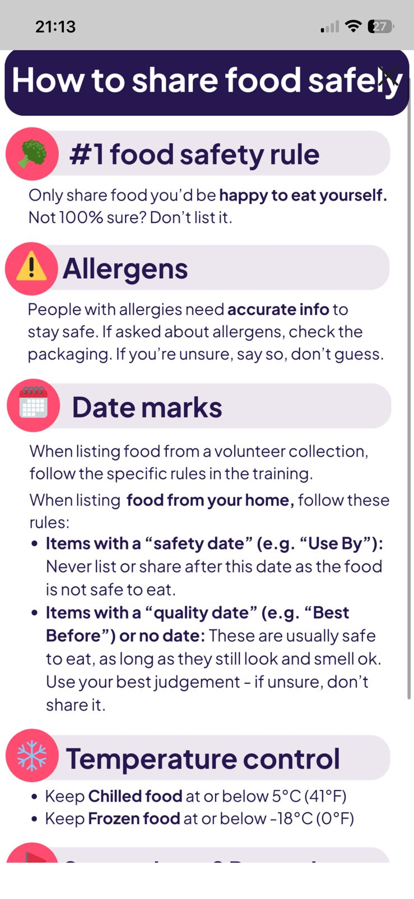
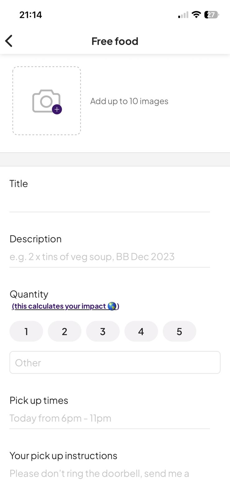
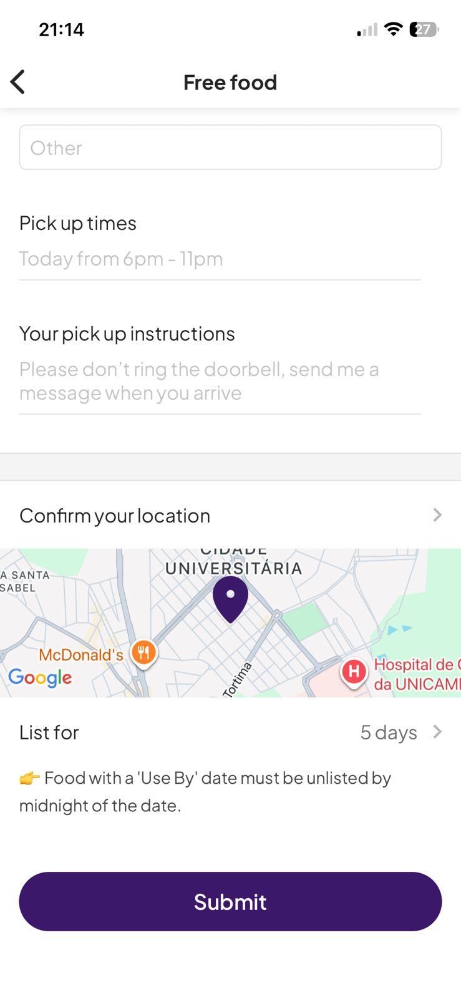
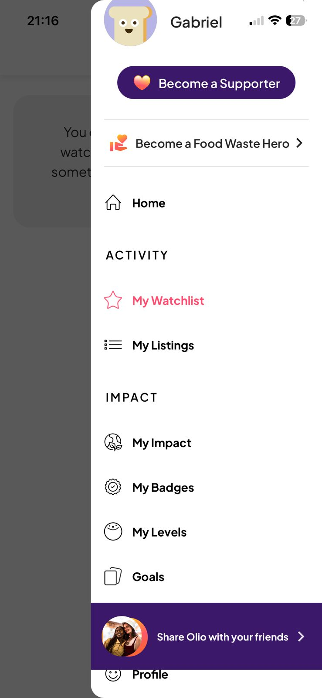

# Aplicações Analisadas:

## OLIO

Consiste em uma aplicação geral para doação de alimentos, doação de objetos, venda de objetos e alimentos e possibilidade de emprestar objetos. A Aplicação se trata de uma solução Mobile que fornece maneiras de conectar pessoas através de um sistema P2P para diversas tipos de doações e vendas.

Em primeiro lugar, podemos ressaltar a feature de adicionar a localização do usuário pode ser feito de maneira dinâmica com a funcionalidade de celular.

Ao clicar em "OK, lets go!" você é redirecionado para uma página com um mapa interativo para adicionar a sua localização.

Após isso, é introduzida uma janela onde o usuário pode se inscrever a um plano premium dentro do aplicativo.

Veja que uma das features disponibilizadas dentro do plano premium é a possibilidade de ver dentro de um mapa dinâmico todas as doações e também receber notificações de doações assim que fiquem disponíveis.

Agora vamos avaliar o fluxo de execução de uma doação dentro do APP. Inicialmente, há um painel com instruções que devem ser seguidas para doação dos alimentos:

Após isso há o painel de adição dos alimentos

Parte 1:

Parte 2:

o Aplicativo disponibiliza diversas features de comunidade e gamificação, além de ter um painel reconhecido por diversos outros aplicativos.

Por fim, não foi possível avaliar quanto à interação de recepção de uma doação, uma vez que não haviam doações disponíveis em Barão Geraldo.

### Pontos Positivos:

- Criação de ambiente de comunidade dentro do aplicativo.
- Definição de localização da doação através de um painel interativo.
- Define instruções de aquisição da doação.

### Pontos Negativos:

- Oferece diversas ferramentas que acaba tornando a aplicação confusa, isto é, parece uma aplicação over-engineered
- Nenhuma doação disponível, ou seja, poucos usuários ativos.
- Planos são caros considerando outros serviços oferecidos pela mesma faixa de preço.

