# Aplicações Analisadas:

## OLIO

Consiste em uma aplicação geral para doação de alimentos, doação de objetos, venda de objetos e alimentos e possibilidade de emprestar objetos. A Aplicação se trata de uma solução Mobile que fornece maneiras de conectar pessoas através de um sistema P2P para diversas tipos de doações e vendas.

Em primeiro lugar, podemos ressaltar a feature de adicionar a localização do usuário pode ser feito de maneira dinâmica com a funcionalidade de celular.

	

Ao clicar em "OK, lets go!" você é redirecionado para uma página com um mapa interativo para adicionar a sua localização.

Após isso, é introduzida uma janela onde o usuário pode se inscrever a um plano premium dentro do aplicativo.

	

Veja que uma das features disponibilizadas dentro do plano premium é a possibilidade de ver dentro de um mapa dinâmico todas as doações e também receber notificações de doações assim que fiquem disponíveis.

Agora vamos avaliar o fluxo de execução de uma doação dentro do APP. Inicialmente, há um painel com instruções que devem ser seguidas para doação dos alimentos:

	

Após isso há o painel de adição dos alimentos

Parte 1:

	

Parte 2:

	

o Aplicativo disponibiliza diversas features de comunidade e gamificação, além de ter um painel reconhecido por diversos outros aplicativos.

	

Por fim, não foi possível avaliar quanto à interação de recepção de uma doação, uma vez que não haviam doações disponíveis em Barão Geraldo.

### Pontos Positivos:

- Criação de ambiente de comunidade dentro do aplicativo.
- Definição de localização da doação através de um painel interativo.
- Define instruções de aquisição da doação.

### Pontos Negativos:

- Oferece diversas ferramentas que acaba tornando a aplicação confusa, isto é, parece uma aplicação over-engineered
- Nenhuma doação disponível, ou seja, poucos usuários ativos.
- Planos são caros considerando outros serviços oferecidos pela mesma faixa de preço.

## Enjoei:

Consiste em uma plataforma de vendas de roupas de lojas oficiais ou vendedores no estilo OLX. Oferece tanto solução Mobile, quanto uma solução Web. Veja que essa aplicação se diferencia da nossa, pois nós estamos preocupado com a doação de alimentos, enquanto a aplicação está mais relacionada com venda de roupas. Desse modo, desejamos colocar essa aplicação por conta de ser um app conhecido quanto a venda por pessoas dentro do app.

A aplicação oferece uma interface com segmentação bem pensada dentro dos campos de roupas, isto é, já são sugeridos campos para buscas comuns, como por exemplo: "Busca por roupas masculinas" ou "Busca por roupas femininas".

	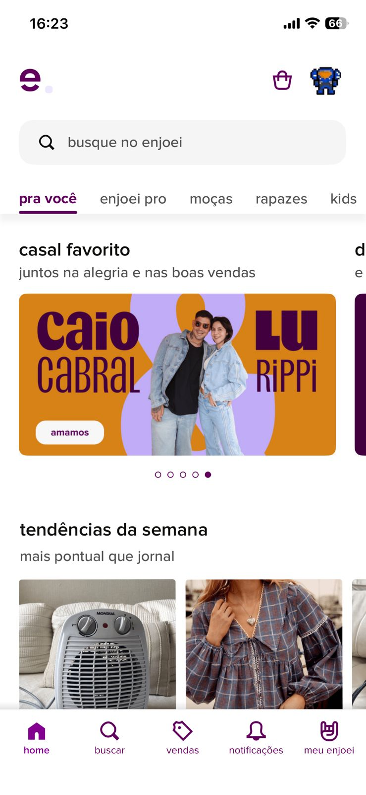

Além disso, o app possibilita definir a localização através do CEP para encontrar ofertas que estejam próximas a você para diminuição do frete. Veja que é menos interativa que a aplicação anterior, contudo ainda fornece um meio funcional para garantir a localização. Sendo mais prático do que preencher um formulário.

	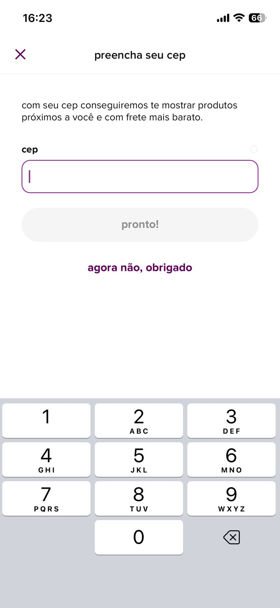

Também há uma ferramenta que possibilita o vendedor tirar fotos dos seus produtos que a própria ferramenta já oferece um mecanismo para classificar as roupas dentro das ofertas e atribuir labels corretos.

	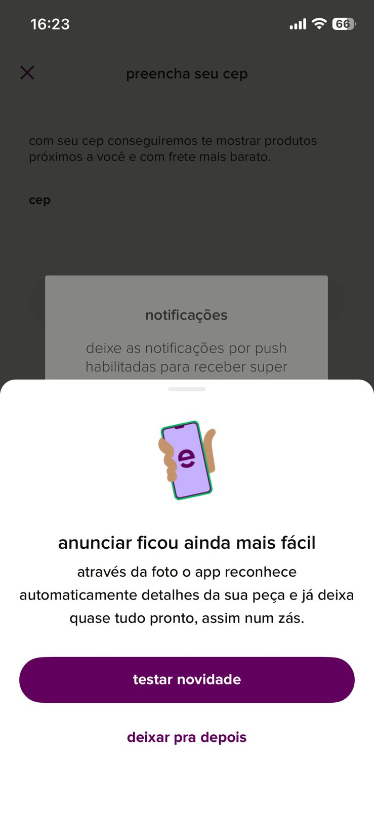

Além disso, o registro de vendedor deve detalhar mais informações do usuário.

	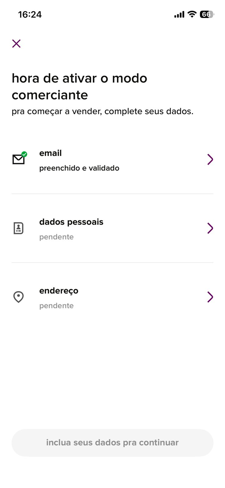

Assim como oferece um mecanismo para avaliação das lojas e além disso oferece o catálogo de produtos oferecidos por essa loja.

	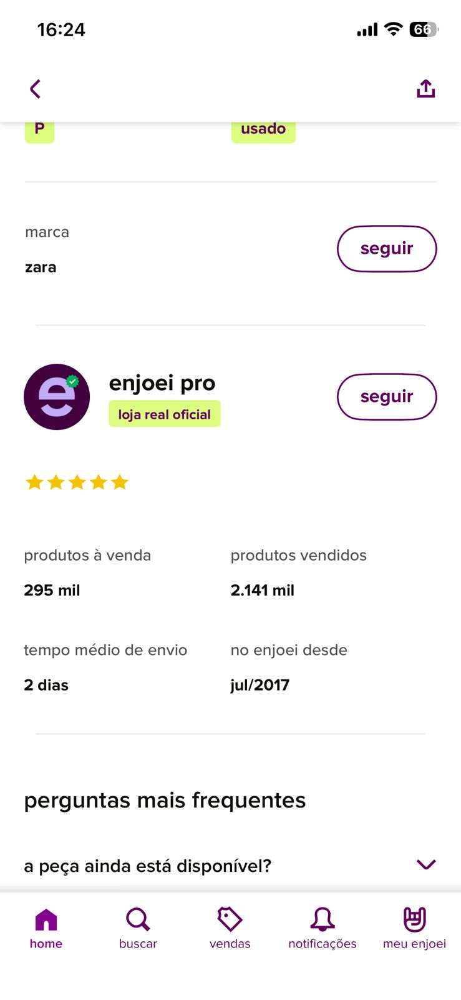

Por fim, a loja oferece uma ferramenta interessante em que são armazenados os posts visitados recentemente:

	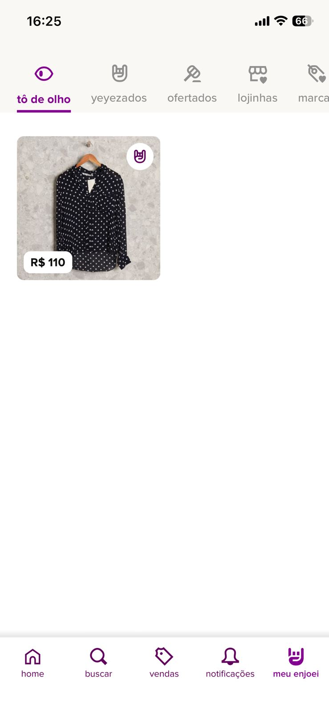

### Pontos Positivos:

- Ferramenta que facilita o preenchimento do formulário para novos produtos.
- Visualização de posts visitados recentemente.
- Ferramenta de buscas bem segmentada

### Pontos Negativos:

- Concorrência de pequenos vendedores com grandes lojas.
- Não oferece diretivas para posts de novos produtos.

## Too Good To Go:

Essa ferramenta também é bem parecida com a primeira ferramenta apresentada, a OLIO, contudo é uma ferramenta que parece ser mais utilizada para vendas de refeições que estão próximas do vencimento com descontos. Contudo, tem um foco muito grande dentro dos países europeus.

Como podemos observar na seguinte imagem há bastante adesão dentro dos países europeus e oferece um mapa interativo para definição da localização:

	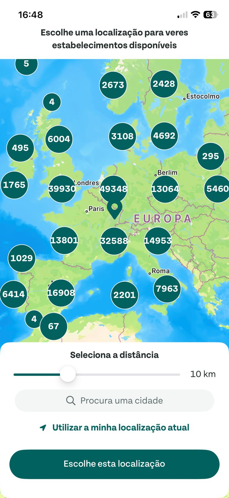

Veja que um problema grande dessa aplicação é não oferecer suporte para regiões da América do Sul.

	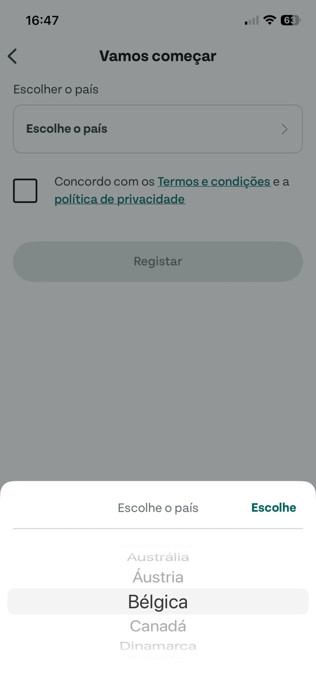

Uma ferramenta boa dentro desse aplicativo é a possibilidade de estabelecer horários para envio de notificações de ofertas:

	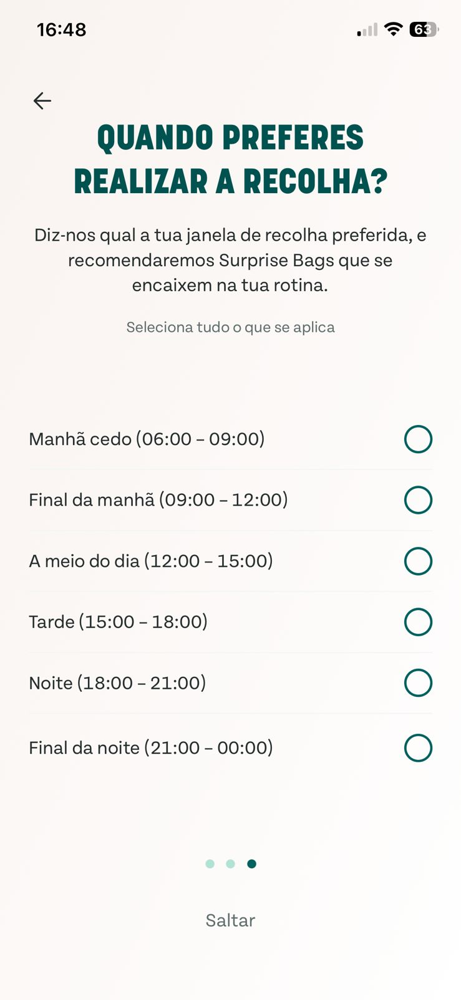

A frontpage do aplicativo também é muito intuitivo oferecendo opções que são próximas de você e que também podem ser coletadas rapidamente. Nesse sentido, o usuário deve ir buscar o seu produto e não há meios de combinar a entrega. Além disso, não há um canal de reclamação/chat muito evidente dentro do aplicativo.

	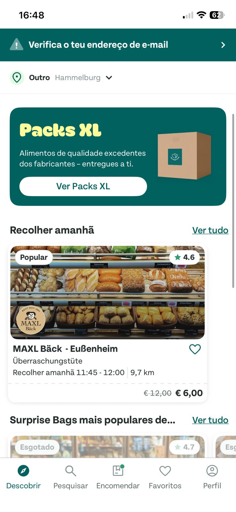

Além disso, o app possui esse esquema de vendas recorrentes pelos estabelecimentos como grandes mercados. Dessa maneira, é possível favoritar alguns produtos:

	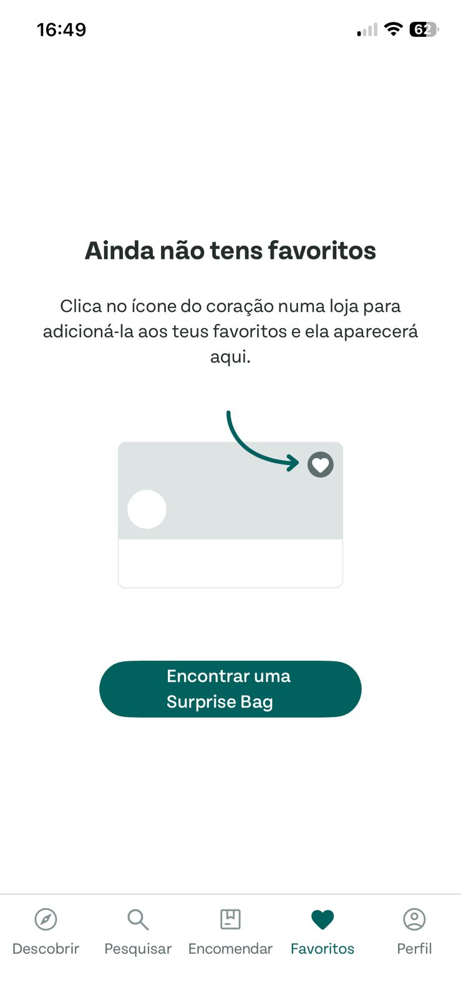

Por fim, o app também possui uma política de incentivo para indicar que amigos participem do aplicativo através da distribuição de cupons por indicação:

	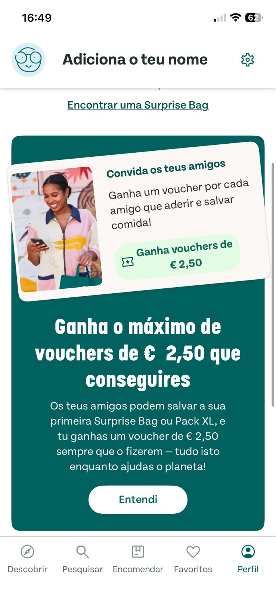

### Pontos Positivos:

- Distribuição de Cupons para indicação de amigos
- Oferecimento de posts baseado na preferência do usuário.
- Maior exposição de pequenos negócios como padarias e restaurantes.
- Restaurantes possuem notas e avaliações.

### Pontos Negativos:

- Nenhum suporte para a região da América do Sul.
- Não há acesso simples a suporte/reclamação.

